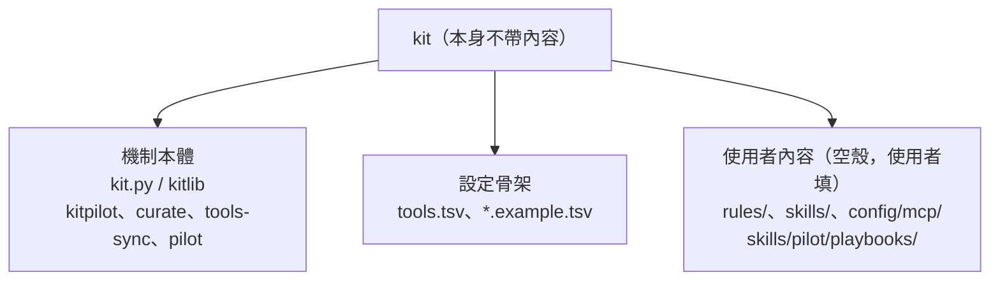
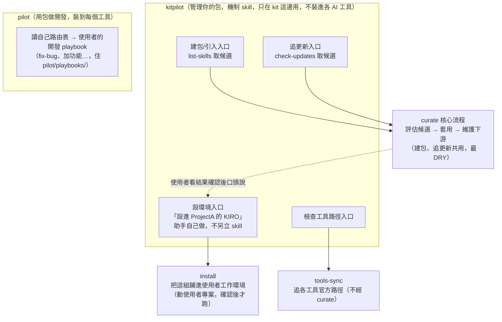
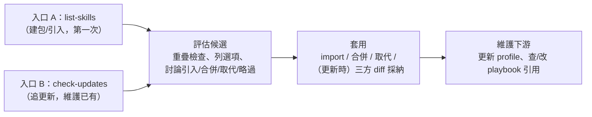
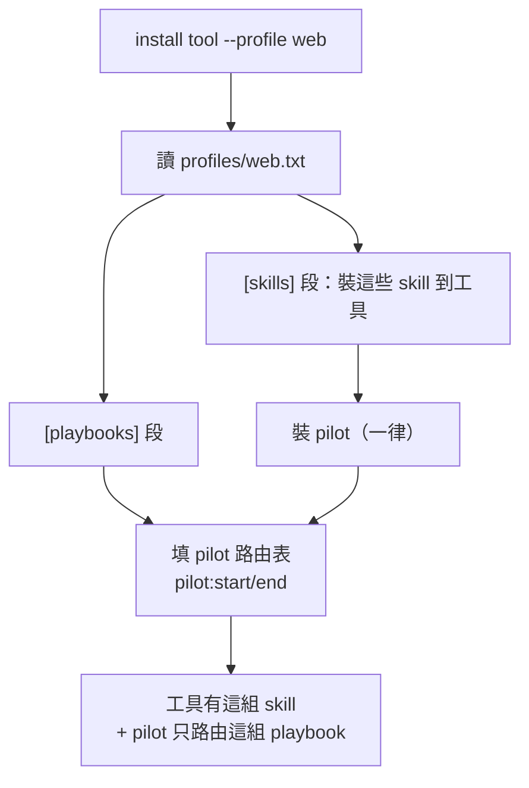

# Playbook、kitpilot/pilot 助手與 curate 核心流程設計

設計討論文件。定義 kit 的兩個對人助手（kitpilot 管包、pilot 用包）、一個核心流程
（curate）、playbook 概念與給人看的 MANIFEST，並記錄已定決策與實作進度。
演進過程不在本文，git 歷史可追。

## 這份文件要解決的問題

kit 原本只做「安裝既有內容」與「追上游更新」，而且假設使用者自己跑 `kit.py`、自己編 tsv。
目標改成：**使用者只對 AI 說話，所有指令、tsv 編輯、檔案操作都由 Agent 代跑。**
kit.py / tsv 是 Agent 的工具，對使用者隱形。使用者介面是自然語言，透過兩個助手。

原本缺的能力：
- 不知道某個上游 repo 有哪些 skill、各自用途。
- 引入時沒有「要不要引入、是否和現有重疊、能不能組合」的判斷協助。
- 裝完後沒有一份「我這套有哪些工具、怎麼用」的地圖。
- 沒有一個跟著「使用者自己這套」走的使用入口。

## 定位：打造 kit 的 kit



kit 附的是「打造 skill 包的工具」，不是一堆現成 skill。成敗在於使用者能多快把空殼
變成自己的包。

## 兩個對人的助手

使用者只需記兩個詞，一個管包、一個用包。



| 助手 | 使用者喊 | 職責 | 裝到工具 |
|---|---|---|---|
| kitpilot | 「kitpilot，設環境 / 引入 repo / 配一組 / 檢查更新」 | 管理包本身 | 否 |
| pilot | 「pilot，修 bug / 加功能」 | 用包做開發 | 是 |

### 兩類 skill 的去向

| 類別 | skill | install 到工具 | 為什麼 |
|---|---|---|---|
| 開發助手 | pilot | ✅ 裝 | 要在各工具裡被「修 bug」呼叫 |
| 機制 | kitpilot、curate、tools-sync | ❌ 不裝 | 只在有 kit 的機器上管包時用 |

機制 skill 不裝進工具，正是 O1（見下）要解的：它們不該洩漏進使用者天天工作的 skill 清單。

## skill 清單

| skill | 角色 | 裝到工具 |
|---|---|---|
| kitpilot | 管包助手，四條路由：建包/追更新→curate、工具路徑→tools-sync、設環境→自己跑 install | 否（機制） |
| curate | 核心流程：評估候選 → 套用 → 維護下游 | 否（機制） |
| tools-sync | 追各工具官方路徑（與 curate 無關，獨立保留） | 否（機制） |
| pilot | 開發助手：靜態路由到使用者的開發 playbook | 是 |

## curate：一個核心流程，兩個入口

建包與追更新經分析其實是**同一個流程，只有「怎麼取得候選」不同**：



後三步（評估、套用、維護下游）兩入口完全相同 → 合成 `curate` 一個 skill，最 DRY。
兩入口只是薄薄的「取候選」那段，由 kitpilot 助手依使用者的話分流，取得候選後都進 curate。

### 維護下游（補的關鍵缺口）

舊流程只更新 skill/rule 內容，不碰 profile 和 playbook。curate 的「維護下游」補上：
skill 被取代改名 → 更新 profile 的 `[skills]`；skill 被引用 → 查 playbook 步驟要不要改。
全是 kit 內部、可逆的動作。建包和追更新都走這步，所以兩者都會通向 playbook。

### curate 不碰使用者環境；install 是獨立一步

curate 只動 kit 內部（引入 skill/rule、配 profile、組 playbook），全可逆、不碰使用者專案。
把這組**鋪進使用者的工作環境**是 install，動到使用者實際專案，有副作用。所以 install 不接在
curate 尾巴自動跑，而是 kitpilot 的第四條獨立路由：使用者看過 curate 的結果、確認沒問題，
口頭說「設進 ProjectA 的 KIRO」，才跑 `install <tool> --profile <name> --workspace <proj>`。

install **不另立 skill**：它的判斷很薄（確認 project 路徑 → workspace、哪個 profile、
copy 還 symlink），kitpilot 助手讀到「設環境」時自己問這三項、跑 install、回報。
curate 和 tools-sync 複雜才值得獨立 skill；install 夠簡單，助手順手做。

## 概念定義：playbook vs 原子 skill

沿用 poteto-mode 的檔案約定，不發明新格式。

| | 原子 skill | playbook |
|---|---|---|
| 存放 | `skills/<name>/SKILL.md` | `skills/pilot/playbooks/<name>.md` |
| 內容 | 一個能力怎麼做 | 多步流程，每步呼叫哪個 skill |
| 來源 | 自己寫或上游引入 | 自己寫，或 curate 從既有 skill 組出草稿 |
| install | 獨立裝到各工具（由 profile 決定） | 不獨立，跟著 pilot 資料夾走 |

playbook 和原子 skill 都是 Markdown，差別只在「多步流程」vs「單一能力」，以及 playbook
是 pilot 的內部檔。零新格式，和 poteto-mode 一致。

## pilot：你的 poteto-mode（靜態路由）

pilot 的運作和 poteto-mode 完全一樣：SKILL.md 裡有一份「情境 → playbook」對照表，
AI 讀那段文字自己判斷該開哪個 playbook。沒有中間層，不讀 MANIFEST，靜態路由。

唯一的差別，也是這個 kit 的意義：

| | poteto-mode | pilot |
|---|---|---|
| playbook 哪來 | pstack 作者寫死的 23 個 | curate 幫使用者建的 |
| SKILL.md 路由表哪來 | 作者手寫 | curate 建 playbook 時、install 依 profile 填 |
| 怎麼路由 | 讀自己 SKILL.md 對照表 | 一樣 |

**MANIFEST 不參與路由。** 它是給人看的地圖，pilot 不讀它。pilot 的路由靠自己 SKILL.md
的對照表。

**為何不直接用 poteto-mode：** poteto-mode 綁 Cursor 的 subagent、slash command，且
playbook 是 pstack 作者那 23 個。本 kit 要跨工具 + 使用者自己的 playbook，所以自建輕量入口。

## MANIFEST.md 內容（純給人看）

MANIFEST 是**產物不是介面**：人讀它了解自己這套，不被程式 parse。放在 `pilot/MANIFEST.md`。
由 `kit.py manifest` 產骨架（確定性表格），Agent 補每個 playbook 的 Mermaid 流程圖（M2）。

```
# 我的工作包 (profile: web)

## Playbooks（多步工作流）
### fix-bug — 修一個可重現的缺陷
  <Mermaid 流程圖，Agent 補>
  來源：自組 | 裝到：kiro, cursor

## 獨立 skill
| skill | 用途 | 來源 | 裝到 |
|---|---|---|---|
| unslop | 去除文字 AI 味 | pstack | kiro, cursor |

## Rules
| rule | 載入模式 | 來源 |
```

MANIFEST.md 在範本 repo 被 gitignore（它是使用者產物，隨 profile 而異）；使用者自己的
fork 可選擇 commit。

## Profile：選擇性安裝

### 起因

兩個需求疊在一起，用一套 profile 清單機制同時解決：

1. **O1**：install 曾用 `skills/*/` 掃**所有** skill 裝到工具，連機制 skill 都洩漏進使用者工具。
2. **不同 workspace 裝不同組**：web 專案要前端那組，infra 專案要維運那組。

### profile 清單格式

```
skills/profiles/<name>.txt

[skills]
# 裝到工具的 skill（一行一個資料夾名）
diagnose
unslop

[playbooks]
# 填進 pilot 路由表的 playbook（一行：<情境> -> <檔名>）
修一個可重現的缺陷 -> fix-bug.md
理解或查證、不改程式 -> investigate.md
```

- `[skills]` 段 → install 把這些 skill 裝到工具。
- `[playbooks]` 段 → install 把這些列進 pilot 的 `pilot:start/end` 路由表。
- 沒列到的 skill 不裝（機制 skill 自然被排除，不必另立 ignore）。
- `pilot` 不需列，install 一律裝它（它是路由基礎設施）。

### install 行為



- `install <tool>`（無 `--profile`）→ 用 `default.txt`。
- playbook 檔案全放一池 `skills/pilot/playbooks/`，清單決定每個 profile 露出哪些。
  一個 playbook 可出現在多個 profile（跨 profile 共用，零複製）。
- pilot 路由表因 profile 而異，所以帶自訂路由表的 pilot 需搭 `--copy`
  （symlink 的 pilot 指回 repo 源檔，無法每 profile 不同）。

### 和既有機制的一致性

profile 清單呼應 kit 的 tsv 哲學：「哪個裝哪」是關係資料，放清單，不硬編在檔名或目錄，
和 tools.tsv 同構。pilot 路由表填寫沿用 B 類 rule 的 `pilot:start/end` 區塊標記。

## 已定決策

| # | 決策 | 定案 |
|---|---|---|
| D1 | 列 repo skill | 子命令 `list-skills <source>`，可獨立測、Agent 與人都能用 |
| D2 | MANIFEST 生成 | M2：`kit.py manifest` 產表格骨架，Agent 補 playbook 流程圖 |
| D3 | playbook 草稿格式 | 照 poteto-mode：步驟清單 + 每步呼叫的 skill，零新格式 |
| D4 | 開發入口命名 | `pilot` |
| D5 | playbook 納不納 install | 跟著 pilot 資料夾走，不獨立 install，tools.tsv 不加欄 |
| D6 | 管包與用包的 skill 切分 | 兩層：kitpilot（管包助手，不裝）與 pilot（用包，裝）；curate 為共用核心 |
| D7 | pilot 路由表格式 | 照 poteto-mode：一行「情境 -> playbooks/<檔名>.md」 |
| D8 | 路由表怎麼更新 | 重寫整段（冪等），`<!-- pilot:start -->`～`<!-- pilot:end -->` 框住，框外手寫保留 |
| D9 | playbook 呼叫 skill 標不標工具語法 | 不標，用中性自然語言，避免綁單一工具 |
| D10 | O1 + 選擇性安裝 | profile 清單，清單決定裝哪些，不靠檔名前綴或分目錄 |
| D11 | pilot 在 profile 下 | 一律裝；路由表由 install 依 profile 的 `[playbooks]` 填 |
| D12 | 清單區分 skill / playbook | 兩段：`[skills]` 裝工具，`[playbooks]` 填 pilot 路由表 |
| D13 | 機制 skill 排除 | 不在任何 profile 的 `[skills]` 即不裝；pilot 例外 |
| D14 | 核心流程是合還是拆 | 合成 curate 一個 skill + 兩個入口（建包、追更新），最 DRY |
| D15 | install 要不要獨立 skill | 否，併進 kitpilot 助手自己做 |

共同原則：照 poteto-mode 或沿用現有機制，不發明新東西。

## 實作進度（feat/setup-wizard-pilot 分支）

| 項目 | 狀態 | commit |
|---|---|---|
| `list-skills <source>` 子命令 | ✅ | 942e085 |
| pilot 骨架 + 範例 playbook fix-bug | ✅ | 3ef2545 |
| profile 機制（解 O1 + 選擇性安裝 + 路由動態填） | ✅ | 38f69e2 |
| `kit.py manifest`（M2 骨架） | ✅ | 645cf66 |
| kitpilot 助手 skill（四條路由） | ✅ | （本批） |
| curate 核心流程 skill（含舊 upstream-sync 的 diff/合併） | ✅ | （本批） |
| 移除舊 setup-wizard、upstream-sync（併入 kitpilot/curate） | ✅ | （本批） |

D14/D15 已落到程式：setup-wizard 和 upstream-sync 移除，共同流程合進 `curate`，
兩種入口 + install + profile 合進 `kitpilot` 助手，tools-sync 保留獨立由 kitpilot 路由。

pstack 兩個 agent（poteto-agent、comment-sicko）本 kit 不處理：Kiro/Antigravity 無對應
的 subagent 格式，且 pilot 不走 subagent 派工。
