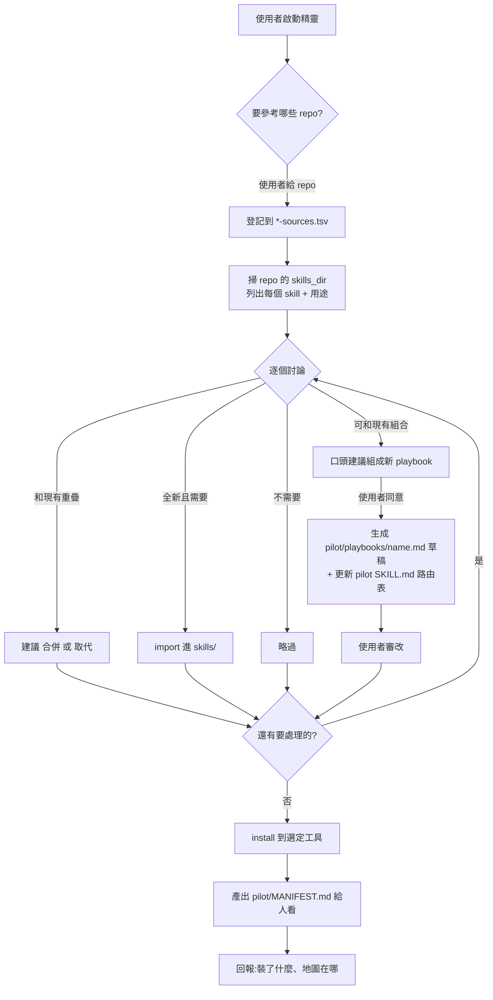
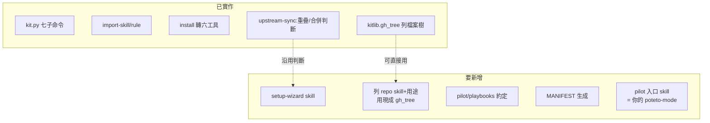

# Playbook、setup 精靈與 pilot 入口設計

設計討論文件。定義三個新概念（playbook、setup-wizard 精靈、pilot 入口）與一份
給人看的 MANIFEST，並釐清哪些沿用現有機制、哪些要新增。尚無程式實作，本文是實作前的對齊。

## 這份文件要解決的問題

目前 kit 只做「安裝既有內容」與「追上游更新」。使用者 clone 後得自己讀 README、
逐條下指令，而且：

- 不知道某個上游 repo 裡有哪些 skill、各自用途。
- 引入時沒有「要不要引入、是否和現有重疊、能不能組合」的判斷協助。
- 裝完後沒有一份「我這套有哪些工具、怎麼用」的地圖。
- 沒有一個跟著「使用者自己這套」走的使用入口。

pstack 的 `poteto-mode` 解決了最後一項，但它的 playbook 和路由表是 pstack 作者寫死的。
本設計要的是「使用者自己的 poteto-mode」：入口運作一樣（靜態讀自己 SKILL.md 路由表），
但 playbook 和路由表由 setup-wizard 幫使用者建與維護，跟著使用者實際裝了什麼走。

## 定位：打造 kit 的 kit

```
                   本身不帶內容
                        │
        ┌───────────────┼───────────────┐
        ▼               ▼               ▼
     機制本體        設定骨架        使用者內容
   kit.py/kitlib    tools.tsv        rules/
   upstream-sync    *.example.tsv    skills/
   tools-sync                        config/mcp/
   setup-wizard                      skills/pilot/playbooks/
   (本設計新增)                      (本設計新增)
                                          │
                                     空殼，使用者填
```

kit 附的是「打造 skill 包的工具」，不是一堆現成 skill。成敗在於使用者能多快把空殼
變成自己的包。

## 兩個 skill：setup-wizard 與 pilot

這是本設計最重要的區分。精靈和入口是**兩個**獨立 skill，不是一個。

| | setup-wizard（精靈） | pilot（入口） |
|---|---|---|
| 何時用 | 建包時（偶爾，建完閒置） | 每天工作時（頻繁） |
| 誰觸發 | 使用者說「幫我建包」 | 使用者說「幫我修 bug」 |
| 做什麼 | 登記、列、討論、import、組 playbook、維護 pilot 路由表、產 MANIFEST | 讀自己 SKILL.md 路由表，開對應 playbook |
| 要不要鋪到各工具 | 否，留在 kit（像 upstream-sync） | 是，裝到每個工具，天天用 |
| 類比 pstack | pstack 沒有建包精靈 | poteto-mode |

分開的理由：入口要裝到每個工具、天天觸發；精靈只在建包時用一次。合成一個會讓天天用的
入口夾帶一堆建包邏輯，違反「一個 skill 一件事」。而且 playbook 住在 **pilot** 的資料夾，
精靈只是「寫檔進那個資料夾」的人——寫的人和被寫的對象本該分開。

## 關鍵結構：playbook 住在 pilot 內（poteto-mode 式）

poteto-mode 的 playbook 不是獨立 skill，而是住在 `poteto-mode/playbooks/*.md`，
是那個 skill 的**內部檔案**，用相對路徑讀。本設計照抄這個結構：

```
skills/
├── setup-wizard/          精靈：建包時用，留在 kit，不鋪到工具
│   └── SKILL.md
└── pilot/                 入口：裝到每個工具，天天用
    ├── SKILL.md           情境→playbook 路由表（= poteto-mode）
    ├── playbooks/         playbook 都住這（精靈往這寫草稿）
    │   ├── fix-bug.md
    │   └── ...
    └── MANIFEST.md        精靈產，pilot 相對路徑讀
```

這個結構一次解掉所有疑慮：

| 疑慮 | poteto-mode 式解法 |
|---|---|
| playbook 要不要獨立 install？ | 不。跟著 `pilot` 這一個 skill 一起走 |
| 單檔 vs `<name>/SKILL.md` 格式衝突？ | 不衝突。playbook 是 skill 內部檔，不需符合 skill 格式 |
| pilot 怎麼找到 playbooks？ | 相對路徑，就在自己資料夾裡 |
| tools.tsv 要不要加欄？ | **完全不用**。install 複製 `pilot/` 資料夾時自然帶上 playbooks |

## 四個角色與資料流

```mermaid
flowchart TD
    U[使用者] -->|說「幫我建我的工作包」| W[setup-wizard 精靈]
    W -->|1 登記來源| SRC[(skill-sources.tsv<br/>rule-sources.tsv)]
    W -->|2 掃來源列 skill+用途| GH[上游 repo<br/>經 gh_tree/gh_extract]
    W -->|3 討論 引入/合併/組 playbook| U
    W -->|4 import + 改寫| CONTENT[skills/ rules/ config/mcp/]
    W -->|5a 同意後生成草稿| PB[skills/pilot/playbooks/*.md]
    W -->|5b 更新路由表| PSK[skills/pilot/SKILL.md<br/>情境→playbook 對照表]
    W -->|6 install| TOOLS[六個 AI 工具]
    W -->|7 產出地圖| MF[skills/pilot/MANIFEST.md]
    MF -->|人閱讀| U
    TOOLS -. 含 pilot .-> PILOT[pilot 入口]
    PILOT -.讀自己 SKILL.md 路由表.-> PSK
    PILOT -.開對應.-> PB
    PB -.步驟呼叫.-> CONTENT
```

| 角色 | 是什麼 | 職責 | 產物 |
|---|---|---|---|
| setup-wizard | 一個 skill（留在 kit） | 引導建包：登記、列、討論、import、組 playbook、更新 pilot 路由表、install、產地圖 | playbook 草稿、pilot 路由表、MANIFEST |
| playbook | `pilot/playbooks/<name>.md` | 一串步驟的工作流，步驟中呼叫原子 skill | 檔案本身 |
| MANIFEST | `pilot/MANIFEST.md` | **純給人看**的地圖：有哪些 playbook、流程圖、獨立功能。不參與路由 | 檔案本身 |
| pilot | 一個 skill（鋪到各工具） | 靜態路由（= poteto-mode）：讀自己 SKILL.md 的對照表，開對應 playbook | 執行期行為 |

## 概念定義：playbook vs 原子 skill

沿用 poteto-mode 的檔案約定，不發明新格式。

| | 原子 skill | playbook |
|---|---|---|
| 存放 | `skills/<name>/SKILL.md` | `skills/pilot/playbooks/<name>.md` |
| 內容 | 一個能力怎麼做 | 多步流程，每步呼叫哪個 skill |
| 來源 | 自己寫或上游引入 | 自己寫，或精靈從既有 skill 組出草稿 |
| install | 獨立裝到各工具 | 不獨立，跟著 pilot 資料夾走 |

playbook 和原子 skill 都是 Markdown，差別只在「多步流程」vs「單一能力」，
以及 playbook 是 pilot 的內部檔。零新格式，和 poteto-mode 一致。

## setup-wizard 流程



關鍵行為（本設計的核心新增）：

- **引入時先檢查現有。** 不是無腦抄進來。精靈比對新 skill 和已裝的，分三類處理：
  重疊、可組合、全新。重疊與合併的判斷，`upstream-sync` 第 3-5 步已有一半，精靈沿用。
- **「組 playbook」是口頭建議 + 同意後生成草稿。** 精靈看到 `diagnose`+`fix`+`test`+`pr`
  四個獨立 skill，口頭說「這四個可組成『修 bug』playbook」。使用者同意，精靈才生成
  `pilot/playbooks/fix-bug.md` 草稿（串好步驟、標明每步呼叫哪個 skill），交使用者審改。
  精靈不自作主張寫檔。

## MANIFEST.md 內容（純給人看）

MANIFEST 是**產物不是介面**：人讀它了解自己這套，不被程式 parse。每次 setup 後重生，
放在 `pilot/MANIFEST.md`，pilot 用相對路徑讀。

```
# 我的工作包

## Playbooks（多步工作流）
### fix-bug — 修 bug 的完整流程
  <Mermaid 流程圖：diagnose → fix → test → pr>
  來源：自組 | 裝到：kiro, cursor

## 獨立功能（非 playbook 的單一 skill）
| skill | 用途 | 來源 | 裝到 |
|---|---|---|---|
| unslop | 去除文字 AI 味 | pstack | kiro, cursor |

## Rules
| rule | 載入模式 | 來源 |
...
```

流程圖用 Mermaid，給人理解 playbook 怎麼走，不是給機器解析。

## pilot 入口（= 你的 poteto-mode）

pilot 的運作**和 poteto-mode 完全一樣**：SKILL.md 裡有一份「情境 → playbook」對照表，
AI 讀那段文字自己判斷該開哪個 playbook。沒有中間層，不讀 MANIFEST，靜態路由。

唯一的差別，也是這個 kit 的意義：

| | poteto-mode | pilot |
|---|---|---|
| playbook 哪來 | pstack 作者寫死的 23 個 | **setup-wizard 幫使用者建的** |
| SKILL.md 路由表哪來 | 作者手寫 | setup-wizard 建 playbook 時一併更新 |
| 怎麼路由 | 讀自己 SKILL.md 對照表 | 一樣，讀自己 SKILL.md 對照表 |

所以 pilot 不是「動態讀 MANIFEST 路由」。它是靜態的，就像 poteto-mode。差別只在它的
playbook 和路由表不是作者寫死，而是 setup-wizard 幫使用者長出來的。這就是
「setup-wizard 幫你寫出你自己的 poteto-mode」。

**MANIFEST 不參與路由。** 它是給人看的地圖，pilot 不讀它。pilot 的路由靠自己 SKILL.md
的對照表（由 setup-wizard 維護）。

**為何不直接用 poteto-mode：** poteto-mode 綁 Cursor 的 subagent、slash command，
且 playbook 是 pstack 作者的那 23 個。本 kit 的價值是跨工具 + 使用者自己的 playbook，
所以要一個「使用者自己的 poteto-mode」，由 setup-wizard 建與維護。

## 現有 vs 要新增



| 項目 | 狀態 | 說明 |
|---|---|---|
| 登記來源 + import | ✅ 已有 | import-skill/rule 完整 |
| 重疊/合併判斷 | ✅ 半有 | upstream-sync 第 3-5 步，精靈沿用並擴充「組 playbook」 |
| 列 repo 有哪些 skill | ⚠ 缺子命令 | kitlib 有 `gh_tree()`，缺一個列出並讀各 SKILL.md 描述的功能 |
| setup-wizard skill | ❌ 新增 | 本設計主體 |
| pilot/playbooks 約定 | ❌ 新增 | 照 poteto-mode，playbook 住 pilot 資料夾內 |
| MANIFEST 生成 | ❌ 新增 | 由精靈寫；若要可重跑再加 `kit.py manifest` |
| pilot 入口 | ❌ 新增 | = poteto-mode；SKILL.md 路由表由 setup-wizard 維護 |

## 實作順序建議

有依賴關係，不能一次做完。地基先行：


第 1 塊最獨立、馬上能驗證（給個 repo，列出它的 skill 和用途），建議從這切入。
pilot 的 SKILL.md 路由表由 setup-wizard（第 3）維護，不是獨立階段——pilot 本身就是
一個靜態 skill（第 2 塊建骨架時一起立），和 poteto-mode 同構。

## 已定決策

| # | 決策 | 定案 |
|---|---|---|
| D1 | 列 repo skill 是子命令還是精靈內做 | 子命令 `list-skills <source>`，可獨立測、精靈與人都能用 |
| D2 | MANIFEST 誰生成 | 精靈生成（只給人看）；需可重跑再加子命令 |
| D3 | playbook 草稿格式 | 照 poteto-mode：步驟清單 + 每步呼叫的 skill，零新格式 |
| D4 | 入口 skill 命名 | `pilot` |
| D5 | playbook 要不要納入 install | **跟著 pilot 資料夾走**，不獨立 install，tools.tsv 不加欄 |
| D6 | 精靈與入口一個還兩個 skill | 兩個：`setup-wizard`（留 kit）與 `pilot`（鋪到各工具） |
| D7 | pilot 路由表格式 | 照 poteto-mode：一行一個「情境描述 → playbooks/<檔名>.md」，AI 讀描述自己判斷 |
| D8 | setup-wizard 怎麼更新路由表 | 重寫整段（冪等，和 playbooks/ 目錄對齊），用 `<!-- pilot:start -->`～`<!-- pilot:end -->` 框住，框外手寫內容保留（沿用 B 類 rule 合併機制） |
| D9 | playbook 步驟呼叫 skill 要不要標工具語法 | 不標。用中性自然語言（「用 diagnose skill 找根因」），不寫 `/diagnose`，避免綁單一工具 |

D5 原本的疑慮（playbook 格式衝突、install 要不要加欄）由 poteto-mode 式結構化解：
playbook 是 pilot 的內部檔，install 複製 pilot 資料夾時自然帶上，tools.tsv 完全不動。

D7-D9 的共同原則：照 poteto-mode 或沿用現有機制，不發明新東西。路由表抄 poteto-mode 的
「Playbooks」段；更新機制沿用 B 類 rule 的區塊標記；跨工具中性描述沿用 ⚠ skill 的教訓。
